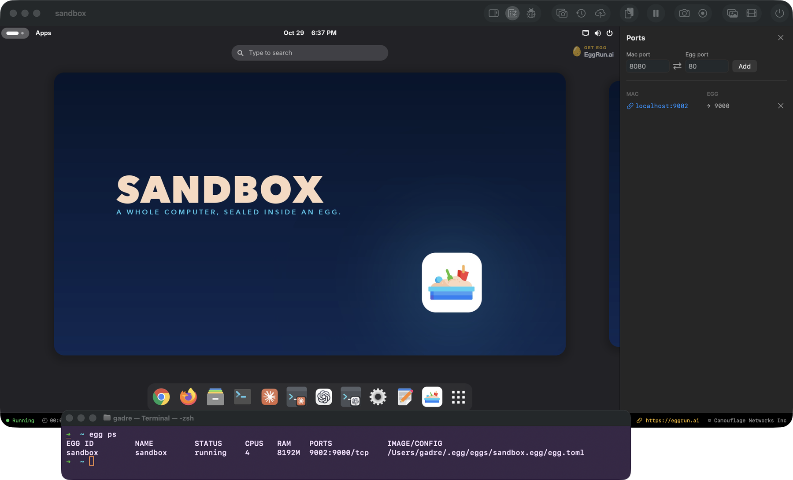

# The command line

Run an egg from a terminal, see what is running, stop it and remove it, and learn the one distinction that makes the rest of Egg make sense: an **egg** is the computer in a file, a **run** is the live machine booted from it.



The app put `egg` on your PATH when it was installed: `/usr/local/bin/egg` points at the app's own copy. Check that it answers:

```bash
egg --version
```

## Run one

```bash
egg run egg/sandbox
```

`egg/sandbox` is a hub reference, always `publisher/slug`. Egg pulls it if you do not have it yet, then boots it in its own window: its own kernel, its own memory, its own devices. There is no daemon; `egg run` is a normal process in your terminal, gone when the egg stops. The first run restores the egg's **warm snapshot**, which is why it appears in seconds instead of booting from cold.

Once pulled, the egg lives on your Mac under its slug, `sandbox`, and that bare name is how you address it from then on. A bare name only ever means a local egg: type `egg run alpine` before you have one and the CLI asks you to say `egg/alpine` rather than guessing. The eggs on the desk and the eggs the CLI sees are the same eggs.

## Look, stop, remove

```bash
egg ps                      # what is running
egg inspect sandbox         # status, hardware, addresses of a running egg
egg stop sandbox            # stop the RUN; the egg stays
egg delete sandbox          # the EGG goes to the recycle bin, restorable
```

On the desk, right-click an egg and choose **Remove** to do what `egg delete` does; the Trash restores it.

## Eggs vs runs

An **egg** is the computer in a file: disk, config, an optional warm snapshot, signed as one bundle. A **run** is a live machine booted from it. One egg boots one machine at a time, because its disk is in use while it runs. Want a second machine? Clone the egg and run the copy; see **Clone and toss**.

Everything an egg owns lives in one folder, `~/.egg/eggs/<name>.egg/`: disks, snapshots, `egg.toml`, card art, the control socket.

## You should now be able to

- run an egg from the terminal and see it in `egg ps`
- stop a run without losing the egg
- say what an egg is and what a run is
