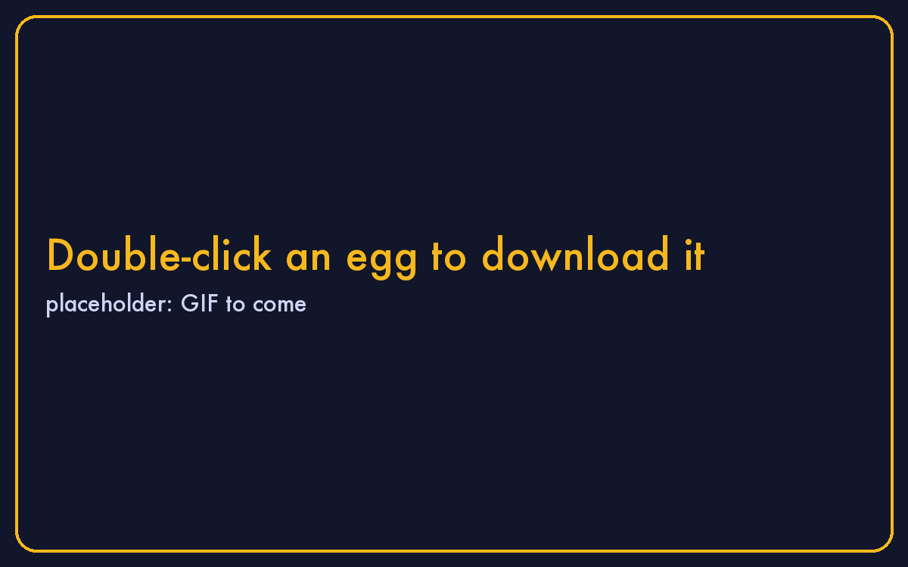

# The egg window

Every egg opens in its own window. The toolbar, left to right:

- **About this egg** (the sidebar button) shows how to sign in, what is inside and how big the machine is. It opens the first time; close it with the × and it stays closed for that egg.
- **Paste** types your Mac's clipboard into the egg (⌘V does the same).
- **Pause** freezes the egg where it is; press again to continue.
- **Screenshot** and **Record** save to the egg's own folder; the two buttons beside them open those folders.
- **Power** shuts the egg down cleanly. Closing the window asks the same question.

## Sign in, packages, security

In the About panel: the account the egg signs you in with, with a copy button and an eye for the password. **N installed** opens the list of every package inside with its version; type to filter, click a name for its page. **Security** shows the hub's vulnerability scan of this build, and **Rescan** checks what is installed now, after your own upgrades.

## Your keyboard and the egg

While the egg's window is in front, what you type goes to the egg. ⌘ with a key stays with the Mac: ⌘V pastes into the egg, ⌘W closes the window, ⌘Q quits. ⌘ on its own reaches the egg as the Super key, which opens the app overview in Sandbox and Ubuntu.

## Size

The window keeps the egg's exact shape. Drag a corner to make it bigger or smaller; **Control-Option-+** and **Control-Option--** zoom in steps, **Control-Option-0** goes back to one pixel per pixel, **Control-⌘F** fills the screen.
