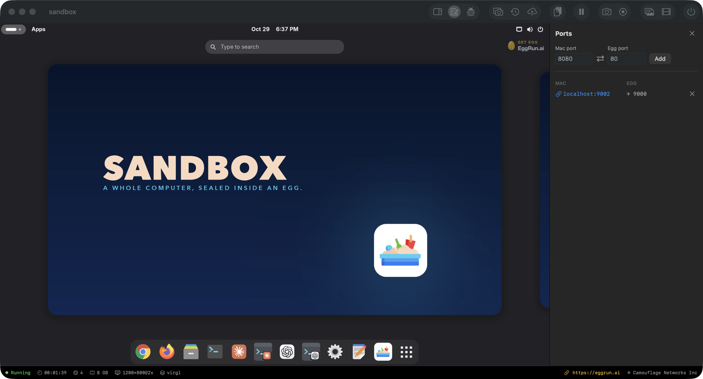

# Ports and folders

Decide what a machine can reach, open the ports you mean to, and share a folder from your Mac. Each egg gets a private gateway: outbound works, nothing inbound unless you forward it. Eggs are kept apart from each other too.



## Ports

Forwards are host:guest, on purpose, when you run the egg:

```bash
egg run web -p 8080:80 -p 2222:22
```

In the egg window's Info panel, Ports lists the forwards; add one as host:guest or remove one with ✕.

## No network at all

```toml
# egg.toml
[network]
mode = "gateway"      # default
# mode = "none"       # a machine with no network at all
```

```eggfile
NETWORK isolated      # the same, in an Eggfile
```

`mode = "none"` is the one to reach for when you open a file you do not trust: the machine has no way to phone home.

## Eggs that see each other

```bash
egg network create backend     # a named subnet a group of eggs can share
egg network ls
```

Eggs whose `egg.toml` names the same network (`name = "backend"` under `[network]`) see each other on that subnet.

## Shared folders

```bash
egg run dev -v ~/code:/work
```

The folder from your Mac mounts inside the machine over virtio-fs. The guest sees the live files; nothing is synced or copied.

## You should now be able to

- forward a port into an egg
- run a machine with no network
- put two eggs on a named network
- share a folder into a machine
